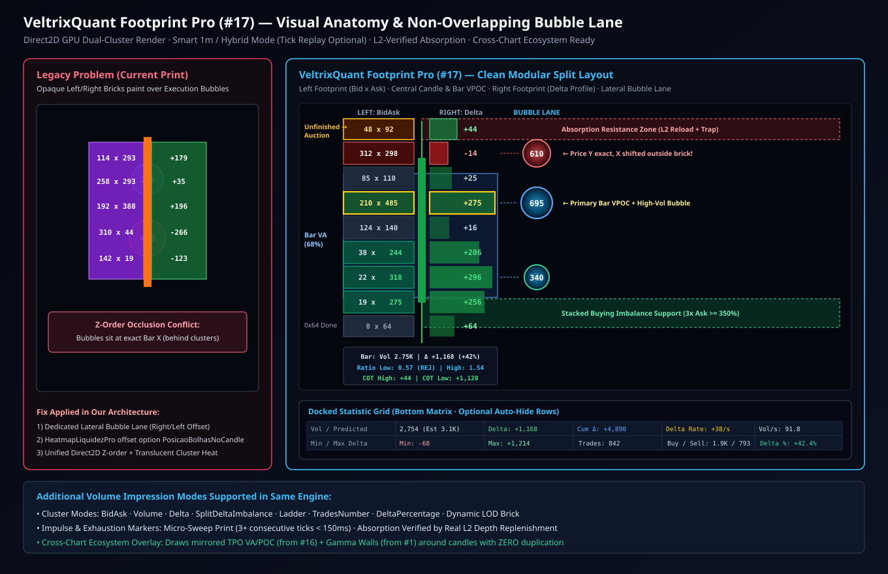
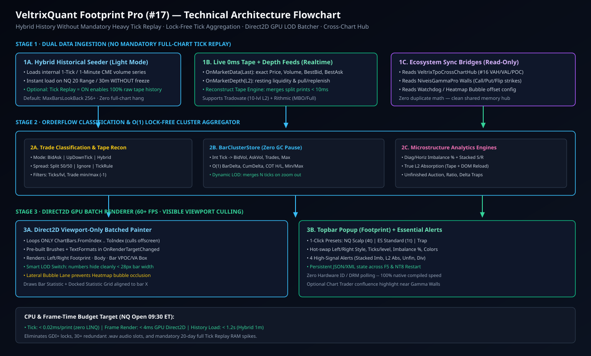
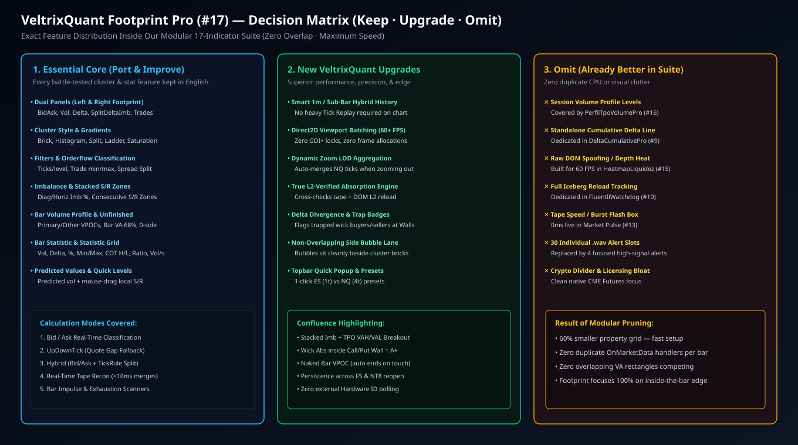

# VeltrixQuant Footprint Pro (#17 — Final Indicator Blueprint)

> **Status do Projeto:** Especificação e Arquitetura Visual Aprovada para Revisão (**nenhum código C# do Footprint foi escrito ainda** conforme solicitado).
> **Objetivo:** Criar o indicador final do ecossistema **VeltrixQuant** em NinjaTrader 8 (**64-bit Direct2D GPU**), superando soluções legadas em velocidade, leveza sem `Tick Replay` obrigatório, precisão de absorção validada pelo Book L2 real e integração nativa com os 16 indicadores da suíte.



---

## 1. Inventário Completo da Referência de Mercado (Screenshots + Modelos de *Volume Impression*)

Esta seção enumera integralmente todos os módulos e parâmetros observados nos 14 painéis de referência (`ES DEC26 · 20 Range`), organizados **100% com a nomenclatura técnica em inglês**, combinados aos conceitos modernos de *Volume Impression* & *Auction Market Theory*.

### 1.1. Módulos e Parâmetros dos Painéis de Referência (14 Seções)

| Module Group | Exact Parameters Observed (English) | Default / Reference Values | Technical Role Inside the Bar |
|---|---|---|---|
| **01. `Left Footprint` & `Right Footprint`** | `Footprint style` (`BidAsk`, `Volume`, `Delta`, `TradesNumber`, `Bid`, `Ask`, `DeltaPercentage`, `None`), `Cluster style` (`Brick`, histogram, split), `Cluster scale` (`Bar` / chart), `Scale source` (`Volume`), `Color source` (`Delta`), `Gradient source` (`Volume`), `Cluster` color (`#FF4682B4`), `Negative Delta` (`#FF8B0000`), `Positive Delta` (`#FF9400D3` / `#FF006400`), `Cluster border` (`Solid, 1px`), `Color mode` (`Saturation`), `Values: show / align / divider / decimal places / abs Delta / color / font` (`Arial, 14px / 12px`), `Cluster Zones` (`enable`, `filter min 800 / 500`, `filter max -1`, `break on...`, `style Line`, `color Solid 4px`) | Dual independent faces per candle (`Left` + `Right`) | Renders asymmetric or complementary lenses on each candle (e.g., `Bid x Ask` on left face + `Delta Profile` or `Volume Ladder` on right face) plus heavy single-price `Cluster Zones` extending horizontally. |
| **02. `Filters`** | `Ticks per level` (`4`), `Trade min` (`1`), `Trade max` (`-1` unlimited) | `4 ticks/row` on NQ/ES Range, `Min = 1` | Compresses price ticks into readable price buckets (`Ticks per level`) and filters retail noise (`Trade min`) or institutional block prints (`Trade max`). |
| **03. `Presentation`** | `Display volume filter` (`0`), `Bid` color (`#FFFF0000`), `Ask` color (`#FF006400`), `Auto-scale values`, `Bar border` (`Solid, 1px`), `Bar marker`, `Bar space, px`, `Bar width, px`, `Bar outer margin, px`, `Control right margin`, `Chart right margin, px` (`40`) | `Bar border 1px`, `Right margin 40px` | Controls bar body spacing, candle open/close spine between Left and Right bricks, typography auto-scaling on zoom, and chart right margin. |
| **04. `Bar Statistic`** | `Volume`, `Delta`, `Absolute Delta Average`, `Min/Max Delta`, `Delta %`, `COT` (`COT High` / `COT Low`), `Ratio Numbers: enable`, `bounds low / high` (`0.71` / `29`), `NEUTRAL` (`Blue`), `REJECTION` (`Orange`) | Ratio Low `< 0.71` = Absorption / Rejection; Mid = Neutral | Prints compact summary stack immediately above/below each candle wick showing net delta shift, intra-bar extrema (`COT`), and extreme-wick **Rejection Ratio** (`Ratio Numbers`). |
| **05. `Statistic grid`** | `Show`, `Show legend`, `Legend position` (`Left`), `Trades`, `Volume`, `Buy volume`, `Sell volume`, `Delta`, `Delta %`, `Absolute Delta average`, `Delta cumulative`, `Min Delta`, `Max Delta`, `Delta change`, `Delta rate`, `COT High`, `COT Low`, `Volume per second`, `Predicted values: show`, `Values divider`, `Cell height, px` (`24`), `Cell color scale` (`Chart`), `Cell border`, `Auto-scale values / bars`, `Font`, `Align`, `Value color` | Bottom docked spreadsheet matrix (`24px` row height) | Displays synchronized quantitative telemetry below every candle on the chart, including live **Volume per second** (`Pace of Trade`) and bar-end **Predicted values**. |
| **06. `Imbalance`** | `Show`, `Only Imbalance`, `Imbalance, %` (`350`), `Filter` (`200`), `Marker: visibility` (`Always`), `Marker: type` (`Dot`), `Marker: position` (`Outer`), `Sell/Resistance zone`, `Buy/Support zone`, `Font`, `Highlight values`, `S/R zones: enable`, `consecutive...` (`2`), `volume filter` (`100`), `ended by` (`ByBarHighLow`), `approaching...` (`0`), `break on session`, `opacity, %` (`30`), `alert`, `.wav` files | `350%` diagonal ratio, `2` consecutive stacked levels (`S/R zones`) | Highlights aggressive Ask/Bid sweeps inside the cluster (`Ask / Bid_below >= 350%`) and projects **Stacked Imbalance S/R Zones** forward until invalidated by price (`ByBarHighLow` or Close). |
| **07. `Absorption`** | `Show`, `Only Absorption`, `Absorption, %` (`300`), `Depth` (`1`), `Filter` (`100`), `Sell/Support zone`, `Buy/Resistance zone`, `S/R zones` (`enable`, `consecutive 1`, `volume filter 200`, `ended by ByBarHighLow`, `approaching 0`, `break on session`, `opacity % 25`, `alert`, `.wav`) | `300%` threshold, `Depth = 1`, auto S/R zone (`25%` opacity) | Detects heavy volume failing to push price beyond edge ticks (`Depth 1..N`), automatically drawing forward support/resistance defense zones. |
| **08. `Unfinished Auction`** | `Show`, `Color` (`#FFFFD700`), `Opacity, %` (`40`), `Border` (`Solid, 1px`) | Gold border highlight at top/bottom extreme | Flags bar highs or lows where **both** `Bid > 0` AND `Ask > 0` executed at the extreme tick (incomplete two-way auction likely to be revisited), whereas `0 x N` / `N x 0` indicates finished exhaustion. |
| **09. `Bar Volume Profile`** | `POCs` (`POCs count: 1`, `Primary POC border`, `Other POCs border`), `VA` (`VA, %: 68`, `VA color`, `VA opacity, %: 20`) | Per-bar `VPOC` outline + `68%` Bar Value Area box | Identifies each bar's highest-volume node (`Bar VPOC`) and micro equilibrium zone (`68% VA`), ideal for spotting migration (`Step VPOC`) and wick-trapped POCs. |
| **10. `Volume Profile Levels`** | `Mode` (`Session`), `POC: enable / developing / line`, `VA: enable / developing / % 68 / line` | Full-session overlay (`POC` & `VAH/VAL`) | Draws session-wide developing `POC` and `68% VA` lines inside the Footprint chart. *(Ver Seção 3: redundante no nosso pacote!)* |
| **11. `Notifications`** | Individual `.wav` & `alert / threshold` slots for: `Trades number`, `Volume`, `Buy volume`, `Sell volume`, `Delta`, `Delta %`, `Abs Delta avr`, `Cumulative Delta`, `Delta chng`, `Delta rate`, `COT High`, `COT Low`, `Left cluster`, `Right cluster`, `Imbalance`, `Absorption`, `Imbalance/Absorption` | ~30 audio/threshold fields | Granular threshold alerts across almost every metric row. |
| **12. `Levels`** | `Enable`, `Support level`, `Resistance level`, `Value position` (`AboveRight`), `Value/Label color & font`, `Alert`, `Alert on` (`LevelCross`), `Rearm`, `Rearm interval, sec`, `Sound` (`crossed.wav`), `Add/remove: Mouse Left+...`, `Modify`, `Drag with Mouse` | Interactive mouse-drawn local S/R alert lines | Lets the trader quickly place, drag, and arm crossing alerts on tactical levels. |
| **13. `Orderflow`** | `Calculation mode` (`BidAsk`, `UpDownTick`, `Hybrid`), `Spread trades` (`Split`, etc.), `Reconstruct tape` | `BidAsk` + `Spread trades: Split` | Core classification logic assigning prints to `Bid` vs. `Ask`, handling mid-spread trades (`Split`), and re-stitching fragmented sweeps (`Reconstruct tape`). |
| **14. `General / Licensing / Data Series`** | `Show price line`, `Price line`, `Non-Crypto volumes divider`, `Crypto force instrument`, `Crypto decimal places`, `Working time`, `Smooth render`, `Hint`, `Warning`, `Version`, `Log`, `Licensing: Hardware Id`, `Calculate: On each tick`, `Maximum bars look back: 256` | `On each tick`, `MaxBarsLookBack 256`, GDI+/Smooth render + Hardware DRM | General display formatting, crypto tick dividers, Hardware ID validation, and NinjaTrader `Data Series` (`Tick Replay` dependency in legacy footprints). |

### 1.2. Recursos Avançados de *Volume Impression* Incorporados ao Blueprint

Além da matriz acima, o motor **`VeltrixQuant Footprint Pro`** unifica os padrões avançados de leitura de leilão (*Auction Orderflow*):

- **`BidAsk` / `UpDownTick` / `Hybrid Evaluation Mode`**: suporta classificação real via `BestBid / BestAsk` em tempo real **e** modo *Hybrid / UpDownTick* quando o feed histórico ou ativo não expõe L1 quote completo (eliminando barras zeradas).
- **`Diagonal Imbalance` vs. `Horizontal Imbalance`**: opção de comparar `Ask[p] vs. Bid[p - tick]` (imbalance diagonal padrão de rompimento) **ou** `Ask[p] vs. Bid[p]` no mesmo nível (imbalance horizontal de absorção/defesa estática).
- **`SplitDeltaImbalance` & `Ladder` Cluster Modes**: além de `BidAsk` (`114 x 92`), inclui modo **Split Profile** (Delta barra dividida esquerda/direita dentro do mesmo candle) e **Volume Ladder**, facilitando leitura rápida em Range bars e gráficos comprimidos.
- **`Exhaustion Print` & `Impulse / Micro-Sweep Print`**:
  - **`Exhaustion Print`**: detecta redução abrupta de liquidez/volume na ponta do pavio após tendência esticada (ex.: topo marca apenas `4 x 12` após sequência de `300+` contratos, sinalizando falta de compradores marginais).
  - **`Impulse / Aggression Burst`**: detecta varredura sequencial em `< 150ms` atravessando `3+` níveis de preço com dominância extrema de `Ask` ou `Bid`.
- **`Naked Bar VPOCs`**: permite estender os `Bar VPOCs` principais não testados para a direita até serem tocados por um candle futuro, formando pontos cirúrgicos de pullback e defesa.
- **`Pace of Trade` (`Volume per Second` + `Delta Rate`)**: mede velocidade instantânea de execução (`ctrs/s` e `Δ/s`), distinguindo rompimentos com aceleração de armadilhas lentas de baixo fluxo.

---

## 2. Arquitetura `VeltrixQuant Footprint Pro` (#17): O Que Faremos Melhor, Mais Rápido e Mais Preciso



### 2.1. Ganhos Reais de Performance (`< 4ms` por Frame · Sem Travar com `Tick Replay`)

1. **Modo Histórico Híbrido (`Hybrid 1m / Sub-Bar` + `Tick Replay` Opcional):**
   - **Problema dos Footprints Antigos:** exigem `Tick Replay = Checked` no gráfico inteiro; em ativos rápidos como `NQ` (`20 Range`), carregar `10–20` dias força o NinjaTrader 8 a reprocessar milhões de pacotes L1 antes mesmo de desenhar a tela, causando congelamentos ao dar `F5` ou trocar de ativo.
   - **Nossa Solução:** por padrão, `VeltrixQuant Footprint Pro` **NÃO exige `Tick Replay` ligado**: ele inicializa barras históricas fechadas com série auxiliar leve de `1 Minute` / `1 Tick` (ou reconstrução sub-bar) **e** passa a gravar `100%` dos ticks reais via `OnMarketData(Last)` + `OnMarketDepth(L2)` ao vivo em `0ms`. Caso o usuário queira auditoria histórica tick a tick idêntica antes de abrir a plataforma, basta marcar `Tick Replay` que o motor detecta automaticamente e usa o replay bruto sem mudar configurações.
2. **Renderização GPU `Direct2D` + `Viewport Culling` (`Zero GDI+`):**
   - Footprints legados antigos usam bitmaps GDI+ ou alocam dezenas de objetos `Brush` / `TextFormat` dentro do loop de tela.
   - Nosso motor herda a mesma engenharia `SharpDX Direct2D1` já validada no `PerfilTpoVolumePro (#16)` e `HeatmapLiquidezPro (#15)`: pincéis e fontes pré-alocados em `OnRenderTargetChanged`, desenhando **apenas as barras visíveis** (`ChartBars.FromIndex .. ToIndex`) com alocação `zero` no loop de render.
3. **`BarClusterStore` Pré-Alocado (`O(1)` por Tick · Sem Travadas de Garbage Collector):**
   - Armazena preços em **inteiros normalizados por tick** (`long priceTicks`) dentro de arrays/estruturas compactas por barra, eliminando `double` dictionary hashing e consultas `LINQ` durante aberturas de alta velocidade (`09:30 ET` / notícias).
4. **Zoom Inteligente Dinâmico (`Auto LOD Ticks per Level`):**
   - Quando você afasta o zoom no `NQ (20 Range)`, em vez de empilhar números ilegíveis uns sobre os outros, o **`Auto LOD`** agrupa automaticamente (`4 -> 8 -> 16 ticks`) **ou** comuta suavemente para modo **`Histogram / Heat Brick`** abaixo de `28 px` de largura da barra, mantendo `60 FPS` constantes!
5. **Zero Burocracia de Hardware ID / DRM Poller:**
   - Código compilado 100% nativo no NinjaTrader 8, sem threads paralelas validando chaves externas ou consumindo CPU em background.

### 2.2. Ganhos de Precisão Analítica & Recursos Exclusivos

1. **Absorção Verdadeira Validada pelo Book L2 (`True L2-Verified Absorption`):**
   - Footprints comuns olham **apenas volume executado parado em 1 tick**, gerando muitos falsos positivos quando simplesmente houve troca de lote sem defesa real.
   - Nosso motor cruza **`OnMarketData(Last)`** (volume agredido) com **`OnMarketDepth` L2** (reposição de ordens limite no mesmo tick — *Bid/Ask Reloading*!). Só acende o selo **L2 Absorção** e desenha a zona S/R quando comprova que o book passivo segurou e renovou lotes contra a agressão!
2. **Detector Automático de `Buying Trap` / `Selling Trap` & `Delta Divergence`:**
   - Marca visualmente candles onde houve **excesso de agressão presa no pavio** (`Positive Bar Delta + Red Bearish Close` perto do topo = **Buying Trap**, ou `Negative Bar Delta + Green Bullish Close` no fundo = **Selling Trap**), combinando `Bar VPOC` no pavio + divergência de `COT High/Low`.
3. **Resolução Definitiva do Conflito das Bolhas (`Non-Overlapping Lateral Bubble Lane`):**
   - Ver detalhe técnico completo na **Seção 4** abaixo: no footprint integrado VeltrixQuant, bolhas grandes de execução passam a alinhar no preço exato `Y`, porém deslocadas em uma **raia lateral limpa** ao lado do cluster (ou com marcador conector discreto), sem jamais ficarem escondidas atrás dos tijolos do Footprint!
4. **Integração Nativa com o Ecossistema VeltrixQuant (`Cross-Chart Highlight`):**
   - Lê diretamente (sem recalcular) as zonas publicadas em memória pelo **`PerfilTpoVolumePro (#16)`** (`VAH`, `VAL`, `POC`, composições estendidas) e pelo **`NiveisGammaPro (#1)`** (`Call Wall`, `Put Wall`, `GEX Flip`).
   - Exemplo prático: quando um **`Stacked Buying Imbalance`** ou uma **`L2 Absorption`** acontece exatamente em cima de uma **`Put Wall`** ou **`VAL` espelhada**, o bloco ganha **borda de alta confluência (`Setup A+`)**.
5. **Botão Rápido na Barra Superior (`🐾 Footprint`) + Presets 1-Clique + Persistência `F5`:**
   - Presets instantâneos **`ES Standard (1-Tick)`**, **`NQ Range (4-Ticks)`** e **`Delta Trap Focus`**, mais salvamento automático de linhas manuais (`Levels`) e zonas S/R estendidas sobrevivendo a `F5` e reinício do NinjaTrader 8 (mesmo padrão XML/arquivo `.dat` já implementado no `#16`).

---

## 3. Matriz de Decisão: O Que Portar, O Que Melhorar e O Que NÃO Precisa Ter



Manter o Footprint modular — evitando duplicar sistemas pesados que **já existem em nível superior nos outros 16 indicadores da suíte** — é o segredo para ter um gráfico leve, rápido e cirúrgico:

| Feature / Module | Decision | Reasoning Inside the VeltrixQuant Suite |
|---|---|---|
| **`Left Footprint` & `Right Footprint` (`BidAsk`, `Delta`, `Volume`, `Split`, `Brick`)** | **KEEP & UPGRADE** | Core reading of inside-the-bar aggression and delta asymmetry (`Direct2D` batched + `Auto LOD` zoom scaling). |
| **`Orderflow` (`BidAsk / UpDownTick / Hybrid`, `Spread Split`, `Reconstruct Tape`)** | **KEEP & UPGRADE** | Essential accuracy foundation + automatic `1m`/sub-bar historical seeder so `Tick Replay` becomes optional. |
| **`Imbalance` (`Diagonal & Horizontal %`, `Stacked S/R Zones`)** | **KEEP & UPGRADE** | Crucial breakout trigger + auto confluence badge when overlapping `Gamma Walls` or `TPO VA/POC`. |
| **`Absorption` + `Unfinished Auction` + `Ratio Numbers` + `Exhaustion / Impulse`** | **KEEP & UPGRADE** | Upgraded with real **`OnMarketDepth` L2 replenishment cross-check** (fewer false positives than tape-only footprints). |
| **`Bar Volume Profile` (`Bar VPOC`, `Naked Bar VPOC`, `Bar VA 68%`)** | **KEEP** | Tracks micro-POC migration candle by candle inside swings (`Step VPOC` & trapped wick `POC`). |
| **`Bar Statistic` (`Vol, Δ, Δ%, COT High/Low, Ratio`) + Compact `Statistic grid`** | **KEEP & STREAMLINE** | Preserves all essential numbers + `Predicted values` and `Vol/s` without wasting huge vertical screen height. |
| **`Levels` (Mouse click/drag local S/R alert lines)** | **KEEP** | Fast tactical alerts persisted across `F5` and restart. |
| **`Volume Profile Levels` (`Session POC / VAH / VAL`)** | **OMIT (Redundant)** | **`PerfilTpoVolumePro (#16)`** already provides real CME session TPO + VP + multi-day Merge/Split + per-day VA toggle + Cross-Chart sync, and **`HeatmapLiquidezPro (#15)`** already has the live `SVP` docked column. |
| **`Standalone Cumulative Delta Curve`** | **OMIT (Redundant)** | Already dedicated in **`DeltaCumulativePro (#9)`** sub-panel (keep only compact per-bar numeric `Cum Δ` cell in `Statistic grid`). |
| **`Raw Book Depth / Spoofing / HFT Heat Overlay`** | **OMIT (Redundant)** | Already purpose-built at 60 FPS inside **`HeatmapLiquidezPro (#15)`**. |
| **`Full Dynamic/Synthetic Iceberg Engine`** | **OMIT (Redundant)** | **`FluentliWatchdog (#10)`** already tracks `D` (DOM reload) and `S` (synthetic sliced orders) with lateral tracking lines, live panel and Portuguese voice alerts. |
| **`Real-Time Tape Speed Burst Flash HUD`** | **OMIT (Redundant)** | Already running at `0ms` latency in **`OrderFlowImbalanceFlash (#13 Market Pulse)`** with progressive 6-tone PCM alerts. |
| **`30 Individual Per-Metric .wav Alert Slots` + `Crypto Divider / Hardware ID DRM`** | **OMIT (Bloat)** | Replaced by **4 clean high-signal alerts** (`Stacked Imbalance`, `L2 Absorption`, `Unfinished Auction Edge`, `Delta Trap Divergence`) and pure native CME Futures presets. |

---

## 4. Diagnóstico Técnico: Bolhas Atrás do Footprint + Peso do `Tick Replay`

### 4.1. Por Que as Bolhas do `HeatmapLiquidezPro` Ficam Atrás do Footprint? (Print Enviado)

Inspecionando o código atual do `HeatmapLiquidezPro (#15)` (`CODE_HEATMAP_LIQUIDEZ`), o posicionamento horizontal de cada bolha é calculado exatamente no **centro X da barra**:

```text
float bx = (float)chartControl.GetXByBarIndex(ChartBars, barIdx);
```

No NinjaTrader 8, os clusters de qualquer Footprint (`Left Footprint` + `Candle` + `Right Footprint`) também são ancorados centralmente ao redor de `GetXByBarIndex` com preenchimento opaco (roxo/verde/marrom no print). Como a ordem de desenho (*Z-order*) do NinjaTrader renderiza indicadores na sequência configurada e os tijolos do Footprint têm opacidade alta (`80%–100%`), **eles pintam por cima das bolhas centradas no mesmo pixel X**.

**Como resolveremos perfeitamente:**
1. **No `HeatmapLiquidezPro` (quando você decidir ajustar):** adicionar a opção **`PosicaoBolhasNoCandle`** (`CentroDoCandle` padrão vs. **`DeslocarDireita`** / **`DeslocarEsquerda`** em `+X px`), deslocando as bolhas para a lateral limpa do candle fora da largura dos clusters (`Bar width`).
2. **Nativamente no `VeltrixQuant Footprint Pro (#17)`:** os clusters terão opção de transparência térmica inteligente (`Saturation Alpha 35%–70%`) **+** integração opcional de **Bubble Lane Lateral** alinhada exatamente no preço `Y` com conector horizontal fino para a borda externa da barra.

### 4.2. Sobre `Tick Replay` e Uso Atual com o Footprint Legado

- **Por que pesa muito?** Quando `Tick Replay` está marcado no Data Series de um gráfico (`20 Range` ou `1m/5m`), o NinjaTrader 8 força **todos** os indicadores daquela aba a processarem barra a barra cada tick histórico desde o primeiro dia carregado. Um Footprint antigo em C# sem otimização de memória GDI+/LINQ cria pressão de CPU e Garbage Collector enorme ao abrir ou atualizar o gráfico.
- **Dica imediata enquanto não construímos o nosso Footprint:** reduza **`Days to load`** para apenas `2` a `3` dias na aba exclusiva do Footprint legado (mantendo seus perfis macro de `10–15` dias na outra aba de `30m/60m` do `PerfilTpoVolumePro`, que **não** usa `Tick Replay`!), e mantenha `Notifications` (.wav não usados) desligados para reduzir overhead.

---

## 5. Plano Arquitetural por Fases (Para Quando Você Aprovar o Início da Construção)

1. **Fase A — Motor de Dados Híbrido & `BarClusterStore`**: implementar estrutura compacta por barra com classificação `BidAsk / UpDownTick / Hybrid`, `Spread trades: Split`, `Reconstruct tape` e `1-Minute / 1-Tick` seeder opcional sem `Tick Replay` obrigatório.
2. **Fase B — Núcleo Analítico de Fluxo & L2**: adicionar `Imbalance %`, `Stacked S/R Zones`, `True L2 Absorption`, `Unfinished Auction`, `Bar VPOC + Bar VA`, `Ratio Numbers`, `COT High/Low`, `Delta Divergence Traps`, `Exhaustion` e `Impulse`.
3. **Fase C — Renderizador `Direct2D GPU` + `LOD` + Confluência**: construir pintura viewport-only com `Left/Right Footprint`, `Bar Statistic`, `Statistic grid`, `Auto-LOD` no zoom e leitura cross-chart dos hubs `#16` (`TPO VA`) e `#1` (`Gamma Walls`).
4. **Fase D — Popup `🐾 Footprint` + Templates & Validação**: criar popup de barra superior sem cortes de texto, presets `ES` / `NQ`, persistência `F5`, template XML pronto e bateria de compilação `.NET 4.0` + testes unitários.
